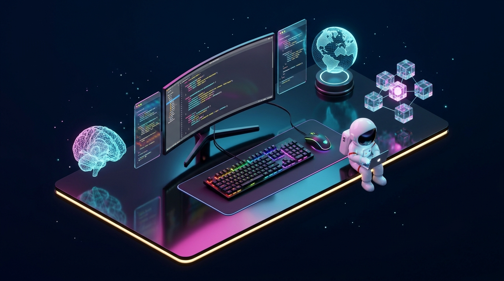

# Interactive 3D Developer Workspace — S.S. Manikanda Prabu

[](https://ssmanikandaprabu.github.io/portfolio-3d/)
[](https://react.dev/)
[](https://www.typescriptlang.org/)
[](https://threejs.org/)
[](https://tailwindcss.com/)

<p align="center">
  <a href="https://ssmanikandaprabu.github.io/portfolio-3d/">
    
  </a>
</p>

An interactive 3D developer workspace portfolio engineered with **React**, **TypeScript**, **Three.js / React Three Fiber**, **Drei**, **Framer Motion**, and **Tailwind CSS**.

---

## ✨ Key Features

- **3D Interactive Hero Workspace (`HeroScene.tsx`):** Reflective obsidian desk (`MeshReflectorMaterial`), curved code monitor with procedural Canvas textures, animated RGB mechanical keyboard & mouse, holographic code panels, 3D AI neural network sphere, floating blockchain cubes, wireframe digital globe, and a developer astronaut figurine with interactive camera focus presets.
- **Interactive 3D Contribution Metropolis (`ContribCity3D.tsx`):** Orbit, zoom, and hover 52 weeks of real GitHub contributions in WebGL 3D (with instant toggle to a 2D heatmap matrix).
- **8 Portfolio Sections:** About Me, Interactive 3D Tilt Skills, Deployed Flagship Projects (with live demos & spec modal), Live GitHub Activity API telemetry, Industry Experience Timeline, SRM IST Education, Certifications & Leadership, and Holographic Contact Terminal.
- **Performance & Accessibility:** Lazy-loaded 3D canvases, `ErrorBoundary` fallback, photorealistic `2D Lite` backdrop for mobile/reduced-motion users, and custom cursor disabled automatically on touch devices.

---

## 🚀 Run Locally

```bash
git clone https://github.com/SSManikandaprabu/portfolio-3d.git
cd portfolio-3d
npm install
npm run dev
```

Build for production:

```bash
npm run build
```

---

## 👤 Author

**S.S. Manikanda Prabu** (`@SSManikandaprabu`)  
B.Tech Computer Science & Engineering · SRM Institute of Science and Technology, Chennai  
- 🌐 Portfolio: [ssmanikandaprabu.github.io/portfolio-3d](https://ssmanikandaprabu.github.io/portfolio-3d/)
- 💼 LinkedIn: [S.S. Manikanda Prabu](https://www.linkedin.com/in/s-s-manikanda-prabu-40070b325/)
- 📧 Email: [ssmanikandaprabu@gmail.com](mailto:ssmanikandaprabu@gmail.com)
